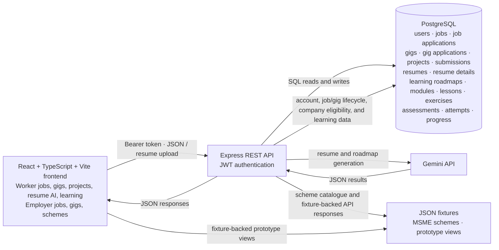
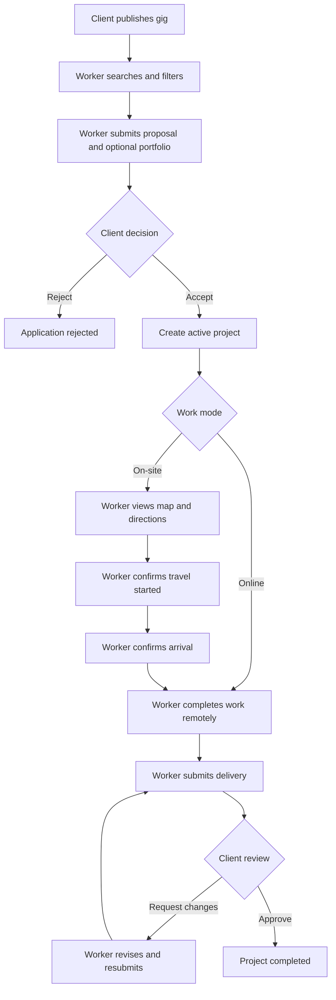
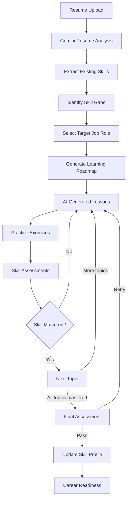

# CareerCrafts / SkillBridge AI

CareerCrafts (SkillBridge AI) is a React and Express employment and career
development prototype. Workers can search jobs and gigs, manage
applications and projects, analyze resumes, and follow personalized learning
roadmaps. Employers can manage job and gig listings and access company-eligibility
and scheme information. Resume analysis and Learning Hub roadmap generation use
Gemini; persistent account, job, gig, resume, and learning data is stored in
PostgreSQL.

## Architecture



The experience is one product: job search and gig work share the worker and
employer portals with resume analysis and personalized learning. Job listings,
applications, gigs, projects, resumes, and roadmaps use the backend and
PostgreSQL. Some secondary prototype views (including messages, notifications,
and several employer summary panels) use JSON fixtures rather than persisted
user data.

The worker account and profile view read the authenticated `users` row and the
latest saved `resumes` analysis. The Learning Hub reads resume skills and gaps,
then asks Gemini to generate lessons, practice exercises, assessments, and a
capstone project for the selected target role. Roadmap content and per-user
progress are stored in the learning tables. This flow does not depend on
`courses`, `course_skills`, or course recommendations; those tables remain
available for future use.

The worker dashboard links to one combined Nearby Jobs view. Its map pins and
job cards use the same job-type filter; the former standalone Maps page and
duplicate dashboard map/job cards have been removed. Government scheme
information is available only in the employer portal. Employer registration
collects a self-declared company size and annual turnover, stores both on the
`users` row, and the backend gates scheme data to micro companies with turnover
up to ₹10 crore or small companies up to ₹100 crore. This is a portal-access
filter, not a substitute for checking each scheme's official eligibility rules.
The current MSME scheme catalogue is sourced from the frontend
`mock/schemes.json` fixture; the company declaration and eligibility are stored
in PostgreSQL.

Gigs use a persisted proposal-to-project lifecycle. Clients publish open online
or on-site gigs; workers search and filter the open listings and apply with a
proposal and optional portfolio link. Accepting one proposal creates a project
and closes the gig to other applications in the same database transaction.
Workers submit delivery notes and an optional work link; clients approve the
submission or request changes. Precise on-site locations are shown only to the
project client and accepted worker, with directions and manual
travel-start/arrival confirmations.
These confirmations do not collect or share continuous device location.

Startup creates the `gigs`, `gig_applications`, `projects`,
`project_submissions`, and `project_location_events` PostgreSQL tables if they
do not already exist.



### Job listing endpoints

These endpoints require a bearer token. Employer routes are restricted to the
signed-in employer and worker routes to worker accounts.

- `POST /api/v1/employer/jobs` — create a job using `title`, `description`,
  `address`, `latitude`, `longitude`, `employmentType` (`full-time`,
  `part-time`, or `contract`), `minSalary`, `maxSalary`, and `requiredSkills`.
- `GET /api/v1/employer/jobs` — list the employer's open jobs.
- `PUT /api/v1/employer/jobs/:jobId` — update an owned open job.
- `DELETE /api/v1/employer/jobs/:jobId` — close an owned open job without
  deleting its application history.
- `GET /api/v1/worker/jobs?lat=<latitude>&lng=<longitude>&radiusKm=<1-100>` —
  find open jobs by distance. Resume skill matches are included when the worker
  has an analyzed resume.
- `POST /api/v1/worker/jobs/:jobId/applications` — apply to an open job.

### Gig marketplace endpoints

All gig endpoints require a bearer token. Worker routes are restricted to
worker accounts and employer routes to the gig creator's employer account.

- `POST /api/v1/employer/gigs` — publish a gig with `title`, `description`,
  `requiredSkills`, `budget`, `deadline` (`YYYY-MM-DD`), and `workMode`
  (`online` or `on_site`). On-site gigs also require `locationAddress` and
  `geo: {"lat": 19.076, "lng": 72.8777}`.
- `GET /api/v1/worker/gigs?q=...&skill=...` — browse open, unexpired gigs and
  search by title, description, creator, or required skill.
- `POST /api/v1/worker/gigs/:gigId/applications` — apply with
  `{"proposal":"...","portfolioUrl":"https://..."}`; portfolio URL is optional.
- `GET /api/v1/worker/gig-applications` — check the worker's submitted proposals
  and their decisions.
- `GET /api/v1/employer/gigs` and
  `GET /api/v1/employer/gigs/:gigId/applications` — list the employer's gigs
  and review proposals.
- `PATCH /api/v1/employer/gig-applications/:applicationId` — decide with
  `{"decision":"accepted"}` or `{"decision":"rejected"}`. Acceptance creates
  the project; only one application can be accepted per gig.
- `GET /api/v1/worker/projects` and `GET /api/v1/employer/projects` — list
  projects visible to the signed-in worker or client.
- `POST /api/v1/worker/projects/:projectId/submissions` — submit
  `{"notes":"...","workUrl":"https://..."}`; an on-site worker must first
  confirm arrival.
- `PATCH /api/v1/employer/projects/:projectId/submissions/:submissionId` —
  review with `{"decision":"approved","feedback":"..."}` or
  `{"decision":"changes_requested","feedback":"Please update..."}`.
- `POST /api/v1/worker/projects/:projectId/location-events` — record
  `{"eventType":"travel_started"}` followed by `{"eventType":"arrived"}` for
  an active on-site project.

### Employer small-business endpoints

These endpoints require an authenticated employer account:

- `GET /api/v1/employer/company-profile` — read the saved company size,
  turnover, and portal eligibility.
- `PUT /api/v1/employer/company-profile` — update the self-declared company
  size and `annualTurnoverCr` value (in crore rupees).
- `GET /api/v1/employer/schemes` — retrieve the scheme catalogue only when the
  company meets the micro/small portal threshold; otherwise returns `403`.

### Learning roadmap flow



Learning data is stored in `learning_roadmaps`, `learning_modules`,
`learning_lessons`, `learning_exercises`, `learning_assessments`,
`assessment_attempts`, `user_learning_progress`, and `learning_projects`.
Backend startup creates or updates these tables alongside the resume-analysis
schema. Roadmap generation requires an analyzed resume and the Gemini API key.

### Learning Hub implementation progress

Roadmap generation uses Gemini JSON output mode without the previously rejected
deep constrained response schema. The prompt requests a bounded roadmap of
three modules, each with one lesson, one exercise, and three questions, plus a
five-question final assessment. The backend validates the complete response
before saving any roadmap data.

Generation has a 45-second per-attempt timeout and one bounded retry. The
second attempt uses `GEMINI_FALLBACK_MODEL` and is triggered by transient
provider/network failures, truncated or malformed JSON, or invalid roadmap
content. Each request is capped at 6,000 output tokens. Exhausted retries
return an error rather than saving an incomplete roadmap. Gemini outages,
quota limits, and unavailable models can still prevent generation.

## Requirements

- Node.js 20.16+ or 22.3+ and npm
- PostgreSQL running locally or reachable from your machine
- A Gemini API key for AI resume analysis and personalized learning roadmaps

## Quick start (Windows PowerShell)

Run commands from the repository root unless a step says otherwise. Keep the
backend and frontend running in separate terminals.

### 1. Configure the backend

Copy and paste this into PowerShell from the repository root to create the
backend environment file:

```powershell
Set-Location .\skillbridge-ai-backend-prototype
@'
PORT=4000
JWT_SECRET=replace-with-a-random-secret-at-least-32-characters
DB_HOST=localhost
DB_PORT=5432
DB_NAME=skillbridge
DB_USER=postgres
DB_PASSWORD=replace-with-your-postgres-password
GEMINI_API_KEY=replace-with-your-gemini-api-key
GEMINI_MODEL=gemini-3.8-flash
GEMINI_FALLBACK_MODEL=gemini-3.5-flash
'@ | Set-Content -Encoding ascii .\src\.env
```

Edit `src\.env` and replace the three `replace-with-...` values with your own
JWT secret, PostgreSQL password, and Gemini API key. To generate a random JWT
secret, run:

```powershell
node -e "console.log(require('crypto').randomBytes(32).toString('hex'))"
```

Create a PostgreSQL database named `skillbridge` (or set `DB_NAME` to an
existing database). The configured `DB_USER` must have permission to create and
update the application's tables. The backend applies the resume-analysis and
learning-roadmap schemas and adds the company-size/turnover columns at startup.

Install dependencies and start the backend:

```powershell
npm.cmd install
npm.cmd start
```

The backend listens on `http://localhost:4000`. Check it in another terminal:

```powershell
Invoke-RestMethod http://localhost:4000/health
```

### 2. Start the frontend

Open a second PowerShell terminal at the repository root:

```powershell
Set-Location .\skillbridge-ai-frontend
npm.cmd install
npm.cmd run dev
```

Open the Vite URL printed in the terminal (normally `http://localhost:3000`).
The frontend's default backend URL is `http://localhost:4000`. To use another
backend URL, create `skillbridge-ai-frontend\.env.local` with:

```dotenv
VITE_BACKEND_API_URL=http://localhost:4000
```

Restart the frontend after changing its environment file.

## Gemini settings

The backend loads `skillbridge-ai-backend-prototype\src\.env`.

| Variable | Default | Purpose |
| --- | --- | --- |
| `GEMINI_API_KEY` | Required for Gemini analysis | Gemini API credential |
| `GEMINI_MODEL` | `gemini-3.8-flash` | Primary model |
| `GEMINI_FALLBACK_MODEL` | `gemini-3.5-flash` | Fallback model for resume analysis and Learning Hub retry |
| `GEMINI_REQUEST_TIMEOUT_MS` | `60000` | Resume-analysis request timeout |
| `GEMINI_RETRY_BUDGET_MS` | `140000` | Resume-analysis retry budget |
| `RESUME_ANALYSIS_JOB_TIMEOUT_MS` | `155000` minimum | Worker job timeout |
| `RESUME_ANALYSIS_JOB_LEASE_MS` | `185000` minimum | Worker lease |

Use model identifiers available to your Gemini API key. A fallback can be
disabled by setting `GEMINI_FALLBACK_MODEL` to the same value as
`GEMINI_MODEL` for resume analysis. Learning Hub generation has a separate
45-second request timeout and at most one retry using the configured fallback
(which may be the same model if both settings match). Restart the backend after
any environment changes.

## Tests and builds

Backend tests:

```powershell
Set-Location .\skillbridge-ai-backend-prototype
npm.cmd test
```

Frontend production build:

```powershell
Set-Location .\skillbridge-ai-frontend
npm.cmd run build
```

## Resume analysis and learning endpoints

All endpoints below require a signed-in worker's bearer token. Resume analysis
and personalized roadmap generation also require the configured Gemini API key.

- `POST /api/resumes/analyze` — upload a PDF/DOCX and optionally include a job
  description; returns a queued analysis job.
- `GET /api/resumes/jobs/:jobId` — poll job status and retrieve its saved result.
- `POST /api/resumes/jobs/:jobId/retry` — retry a failed analysis.
- `GET /api/resumes/latest` — retrieve the signed-in user's latest saved result.

Learning endpoints:

- `GET /api/learning/roadmap` — retrieve the signed-in worker's latest roadmap
  and progress.
- `GET /api/learning/resume-context` — load the latest resume skills without
  reading course or recommendation tables.
- `POST /api/learning/roadmaps` — generate a roadmap from the latest analyzed
  resume and a JSON body such as `{"targetRole":"Frontend Engineer"}`. An
  analyzed resume is required; the endpoint returns `409` if none exists.
- `POST /api/learning/roadmaps/:roadmapId/modules/:moduleId/lessons/:lessonId/complete`
  — save lesson completion.
- `POST /api/learning/roadmaps/:roadmapId/modules/:moduleId/exercises/:exerciseId/complete`
  — save exercise completion after the module lessons are complete.
- `POST /api/learning/roadmaps/:roadmapId/assessments/:assessmentId/attempts`
  — submit JSON answers as `{"answers":[0,1,2]}`. Passing a module assessment
  marks its skill mastered and unlocks the next module; the final assessment
  completes the roadmap.
- `PATCH /api/learning/roadmaps/:roadmapId/projects/:projectId` — update
  capstone status with `{"status":"in_progress"}` or
  `{"status":"submitted"}`.

Roadmap, lesson, exercise, assessment, attempt, progress, and project records
are scoped to the authenticated user. Module assessments require all lessons
and exercises in that module to be completed first. The Learning Hub shows
mastered skills in the worker profile and the current roadmap on the dashboard.

Detailed API and scoring notes are in
[`skillbridge-ai-backend-prototype/src/README.md`](./skillbridge-ai-backend-prototype/src/README.md).

## Secrets

Local `.env` files are ignored by Git. Never commit API keys, database passwords,
or real JWT secrets. Keep `.env.example` files limited to safe placeholders.
