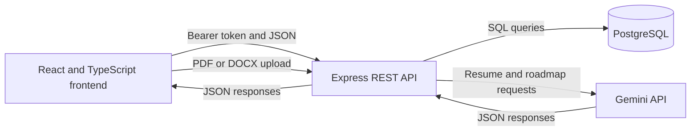

# CareerCrafts / SkillBridge AI

CareerCrafts is a React, TypeScript, Vite, Express, PostgreSQL, and Gemini-based
employment and career-development prototype.

Worker features include:

- Job search and location-based filtering
- Gig search and proposals
- Project submissions and on-site location confirmations
- PDF and DOCX resume analysis
- Job-context-aware resume matching
- Learning roadmaps and progress
- Messages and notifications
- Worker profile and latest resume details

Employer features include:

- Job and gig management
- Gig proposal review
- Project submission review
- Candidate fixtures
- Company profile and small-business scheme eligibility
- Messages and notifications

Some employer dashboard panels and candidate data use local JSON fixtures.
The fixtures are not stored in PostgreSQL account or application records.

## Deployed frontend

- [CareerCrafts login](https://career-crafts-bice.vercel.app/login)

## Project structure

- `skillbridge-ai-frontend/` - React, TypeScript, and Vite client
- `skillbridge-ai-backend-prototype/` - Express API and PostgreSQL integration

## Architecture



## Requirements

- Node.js 20.16+ or 22.3+
- npm
- PostgreSQL
- A Gemini API key for resume analysis and Learning Hub roadmap generation

## Local setup

Run the backend and frontend in separate terminals.

### 1. Configure the backend

From the repository root:

```powershell
Set-Location .\skillbridge-ai-backend-prototype
```

Create `src\.env` with the local database and application settings:

```dotenv
PORT=4000
JWT_SECRET=replace-with-a-random-secret-at-least-32-characters
DB_HOST=localhost
DB_PORT=5432
DB_NAME=skillbridge
DB_USER=postgres
DB_PASSWORD=replace-with-your-postgres-password
GEMINI_API_KEY=replace-with-your-gemini-api-key
GEMINI_MODEL=gemini-3.8-flash
GEMINI_FALLBACK_MODEL=gemini-3.5-flash-lite
```

Create the `skillbridge` PostgreSQL database and ensure the configured database
user can create and alter application tables.

Install dependencies and start the backend:

```powershell
npm.cmd install
npm.cmd start
```

The backend listens on `http://localhost:4000`. Check it with:

```powershell
Invoke-RestMethod http://localhost:4000/health
```

### 2. Start the frontend

In a second terminal:

```powershell
Set-Location .\skillbridge-ai-frontend
npm.cmd install
npm.cmd run dev
```

The frontend defaults to `http://localhost:3000` and sends API requests to
`http://localhost:4000`.

To use another backend URL, create `.env.local`:

```dotenv
VITE_BACKEND_API_URL=http://localhost:4000
```

Restart the frontend after changing this value.

## Implemented worker routes

- `/worker/dashboard`
- `/worker/jobs`
- `/worker/gigs`
- `/worker/projects`
- `/worker/resume-ai`
- `/worker/learning`
- `/worker/profile`
- `/worker/messages`
- `/worker/notifications`

## Implemented employer routes

- `/employer/dashboard`
- `/employer/post-job`
- `/employer/post-gig`
- `/employer/gigs`
- `/employer/candidates`
- `/employer/schemes`
- `/employer/messages`
- `/employer/notifications`

## Main API areas

### Authentication

- `POST /api/v1/auth/register`
- `POST /api/v1/auth/login`
- `GET /api/v1/me`

### Jobs

- `POST /api/v1/employer/jobs`
- `GET /api/v1/employer/jobs`
- `PUT /api/v1/employer/jobs/:jobId`
- `DELETE /api/v1/employer/jobs/:jobId`
- `GET /api/v1/worker/jobs`
- `POST /api/v1/worker/jobs/:jobId/applications`

### Gigs and projects

- `POST /api/v1/employer/gigs`
- `GET /api/v1/employer/gigs`
- `GET /api/v1/employer/gigs/:gigId/applications`
- `PATCH /api/v1/employer/gig-applications/:applicationId`
- `GET /api/v1/worker/gigs`
- `POST /api/v1/worker/gigs/:gigId/applications`
- `GET /api/v1/worker/gig-applications`
- `GET /api/v1/worker/projects`
- `GET /api/v1/employer/projects`
- `POST /api/v1/worker/projects/:projectId/submissions`
- `PATCH /api/v1/employer/projects/:projectId/submissions/:submissionId`
- `POST /api/v1/worker/projects/:projectId/location-events`

### Resume analysis

- `POST /api/resumes/analyze`
- `GET /api/resumes/jobs/:jobId`
- `POST /api/resumes/jobs/:jobId/retry`
- `GET /api/resumes/latest`

Resume analysis supports employer-specific descriptions, recognized role titles,
and resume-only analysis. Scores and requirement matching are calculated by the
backend. Gemini is used for profile extraction and role competency generation.

### Learning Hub

- `GET /api/learning/resume-context`
- `GET /api/learning/roadmap`
- `POST /api/learning/roadmaps`
- `POST /api/learning/roadmaps/:roadmapId/modules/:moduleId/lessons/:lessonId/complete`
- `POST /api/learning/roadmaps/:roadmapId/modules/:moduleId/exercises/:exerciseId/complete`
- `POST /api/learning/roadmaps/:roadmapId/assessments/:assessmentId/attempts`
- `PATCH /api/learning/roadmaps/:roadmapId/projects/:projectId`

### Messaging, notifications, and company eligibility

- `GET /api/chat/contacts`
- `GET /api/chat/conversations`
- `GET /api/chat/conversations/:conversationId/messages`
- `POST /api/chat/messages`
- `PATCH /api/chat/conversations/:conversationId/read`
- `GET /api/notifications`
- `GET /api/notifications/unread-count`
- `GET /api/v1/employer/company-profile`
- `PUT /api/v1/employer/company-profile`
- `GET /api/v1/employer/schemes`

## Tests and builds

Backend:

```powershell
Set-Location .\skillbridge-ai-backend-prototype
npm.cmd test
```

Frontend:

```powershell
Set-Location .\skillbridge-ai-frontend
npm.cmd run build
```

Verification performed for this project:

- Backend: 68/68 tests pass
- Frontend: TypeScript and Vite production build succeeds

## Prototype limitations

- Employer profile, candidate rankings, revenue, and hiring pipeline panels
  currently use local JSON fixtures.
- The scheme catalogue is fixture-backed.
- Employer dashboard fixture data is not tied to saved employer account records.

Keep API keys, database passwords, and JWT secrets out of source control.
