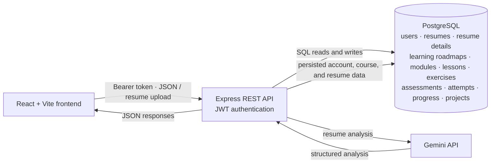
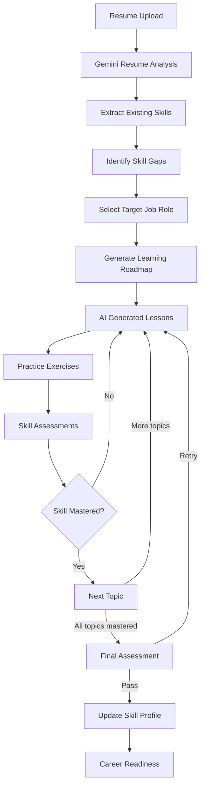

# CareerCrafts / SkillBridge AI

A React frontend and Express backend prototype for job search, skill building,
and AI-assisted resume analysis. Resume files are parsed by the backend, analyzed
with Gemini, and saved in PostgreSQL. The Learning Hub generates and tracks
role-specific learning roadmaps independently of the course catalog.

## Architecture



The worker account and profile view read the authenticated `users` row and the
latest saved `resumes` analysis. The Learning Hub reads resume skills and gaps,
then asks Gemini to generate lessons, practice exercises, assessments, and a
capstone project for the selected target role. Roadmap content and per-user
progress are stored in the learning tables. This flow does not depend on
`courses`, `course_skills`, or course recommendations; those tables remain
available for future use.

### Learning roadmap flow



Learning data is stored in `learning_roadmaps`, `learning_modules`,
`learning_lessons`, `learning_exercises`, `learning_assessments`,
`assessment_attempts`, `user_learning_progress`, and `learning_projects`.
Backend startup creates or updates these tables alongside the resume-analysis
schema. Roadmap generation requires an analyzed resume and the Gemini API key.

## Requirements

- Node.js 20 or newer and npm
- PostgreSQL running locally or reachable from your machine
- A Gemini API key for AI resume analysis and personalized learning roadmaps

## Quick start (Windows PowerShell)

Run commands from the repository root unless a step says otherwise. Keep the
backend and frontend running in separate terminals.

### 1. Configure the backend

Copy and paste this into PowerShell from the repository root to create the
backend environment file:

```powershell
Set-Location .\skillbridge-ai-backend-prototype
@'
PORT=4000
JWT_SECRET=replace-with-a-random-secret-at-least-32-characters
DB_HOST=localhost
DB_PORT=5432
DB_NAME=skillbridge
DB_USER=postgres
DB_PASSWORD=replace-with-your-postgres-password
GEMINI_API_KEY=replace-with-your-gemini-api-key
GEMINI_MODEL=gemini-3.8-flash
GEMINI_FALLBACK_MODEL=gemini-3.5-flash
'@ | Set-Content -Encoding ascii .\src\.env
```

Edit `src\.env` and replace the three `replace-with-...` values with your own
JWT secret, PostgreSQL password, and Gemini API key. To generate a random JWT
secret, run:

```powershell
node -e "console.log(require('crypto').randomBytes(32).toString('hex'))"
```

Create a PostgreSQL database named `skillbridge` (or set `DB_NAME` to an
existing database). The configured `DB_USER` must have permission to create and
update the application's tables. The backend applies the resume-analysis and
learning-roadmap schemas at startup.

Install dependencies and start the backend:

```powershell
npm.cmd install
npm.cmd start
```

The backend listens on `http://localhost:4000`. Check it in another terminal:

```powershell
Invoke-RestMethod http://localhost:4000/health
```

### 2. Start the frontend

Open a second PowerShell terminal at the repository root:

```powershell
Set-Location .\skillbridge-ai-frontend
npm.cmd install
npm.cmd run dev
```

Open the Vite URL printed in the terminal (normally `http://localhost:3000`).
The frontend's default backend URL is `http://localhost:4000`. To use another
backend URL, create `skillbridge-ai-frontend\.env.local` with:

```dotenv
VITE_BACKEND_API_URL=http://localhost:4000
```

Restart the frontend after changing its environment file.

## Gemini settings

The backend loads `skillbridge-ai-backend-prototype\src\.env`.

| Variable | Default | Purpose |
| --- | --- | --- |
| `GEMINI_API_KEY` | Required for Gemini analysis | Gemini API credential |
| `GEMINI_MODEL` | `gemini-3.8-flash` | Primary model |
| `GEMINI_FALLBACK_MODEL` | `gemini-3.5-flash` | Final-attempt fallback |
| `GEMINI_REQUEST_TIMEOUT_MS` | `60000` | Per-request timeout |
| `GEMINI_RETRY_BUDGET_MS` | `140000` | Total request/retry budget |
| `RESUME_ANALYSIS_JOB_TIMEOUT_MS` | `155000` minimum | Worker job timeout |
| `RESUME_ANALYSIS_JOB_LEASE_MS` | `185000` minimum | Worker lease |

Use model identifiers available to your Gemini API key. A fallback can be
disabled by setting `GEMINI_FALLBACK_MODEL` to the same value as
`GEMINI_MODEL`. Restart the backend after any environment changes.

## Tests and builds

Backend tests:

```powershell
Set-Location .\skillbridge-ai-backend-prototype
npm.cmd test
```

Frontend production build:

```powershell
Set-Location .\skillbridge-ai-frontend
npm.cmd run build
```

## Resume analysis and learning endpoints

All endpoints below require a signed-in worker's bearer token. Resume analysis
and personalized roadmap generation also require the configured Gemini API key.

- `POST /api/resumes/analyze` — upload a PDF/DOCX and optionally include a job
  description; returns a queued analysis job.
- `GET /api/resumes/jobs/:jobId` — poll job status and retrieve its saved result.
- `POST /api/resumes/jobs/:jobId/retry` — retry a failed analysis.
- `GET /api/resumes/latest` — retrieve the signed-in user's latest saved result.

Learning endpoints:

- `GET /api/learning/roadmap` — retrieve the signed-in worker's latest roadmap
  and progress.
- `GET /api/learning/resume-context` — load the latest resume skills without
  reading course or recommendation tables.
- `POST /api/learning/roadmaps` — generate a roadmap from the latest analyzed
  resume and a JSON body such as `{"targetRole":"Frontend Engineer"}`. An
  analyzed resume is required; the endpoint returns `409` if none exists.
- `POST /api/learning/roadmaps/:roadmapId/modules/:moduleId/lessons/:lessonId/complete`
  — save lesson completion.
- `POST /api/learning/roadmaps/:roadmapId/modules/:moduleId/exercises/:exerciseId/complete`
  — save exercise completion after the module lessons are complete.
- `POST /api/learning/roadmaps/:roadmapId/assessments/:assessmentId/attempts`
  — submit JSON answers as `{"answers":[0,1,2]}`. Passing a module assessment
  marks its skill mastered and unlocks the next module; the final assessment
  completes the roadmap.
- `PATCH /api/learning/roadmaps/:roadmapId/projects/:projectId` — update
  capstone status with `{"status":"in_progress"}` or
  `{"status":"submitted"}`.

Roadmap, lesson, exercise, assessment, attempt, progress, and project records
are scoped to the authenticated user. Module assessments require all lessons
and exercises in that module to be completed first. The Learning Hub shows
mastered skills in the worker profile and the current roadmap on the dashboard.

Detailed API and scoring notes are in
[`skillbridge-ai-backend-prototype/src/README.md`](./skillbridge-ai-backend-prototype/src/README.md).

## Secrets

Local `.env` files are ignored by Git. Never commit API keys, database passwords,
or real JWT secrets. Keep `.env.example` files limited to safe placeholders.
